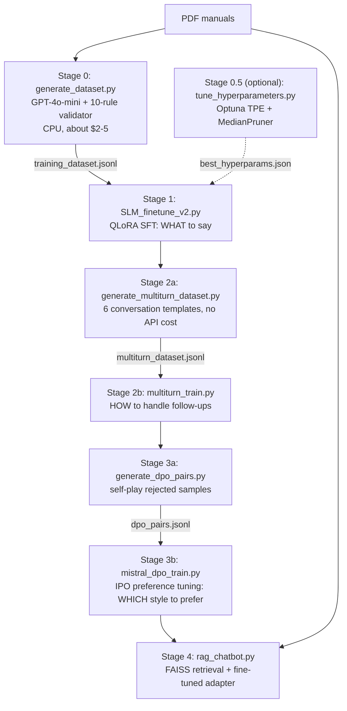

# Doctrine-Tuned SLM: Teaching a 7B Model to Troubleshoot Like a Technician

> Fine-tune Mistral 7B on a free-tier T4 so it doesn't just *know* a service manual, it follows the manual's **diagnostic doctrine**: exhaust software checks first, touch hardware last, and never replace a part without evidence.

Most "fine-tune an LLM on PDFs" projects stop at supervised training and hope the model behaves. This pipeline treats **behaviour** as the target. It builds a validated synthetic dataset from your documents, teaches conversational follow-up, then uses preference training to lock in the ordering rules, and finally serves the model behind a retrieval layer so answers stay grounded in the source manuals.

The worked example is smartphone hardware repair, but only the vocabulary is domain-specific. The pipeline itself adapts to any documented troubleshooting domain.

---

## What the model learns

Every answer follows a fixed structure and a fixed escalation order:

```
Issue:            one-sentence diagnosis
Possible Causes:  numbered, each naming a specific component
Solution:         Step 1..N, least invasive -> most invasive, each tied to a real tool/command
Expected Outcome: observable result + when to escalate
```

Example (from `example_dataset_format.jsonl`), for *"device shows error E-204 on the display after a drop"*:

1. Re-run the built-in Display Test to confirm the fault in software
2. Capture diagnostic logs, check whether E-204 appears at boot or only under touch
3. Only then open the device and re-seat the flex cable
4. Swap in a known-good display to isolate panel vs. board
5. Escalate to board-level repair only if a known-good panel also fails

A generic chat model tends to jump straight to "replace the display". This model is trained to refuse that shortcut.

---

## Pipeline



| Stage | Script | Hardware | What it teaches / produces |
|---|---|---|---|
| 0 | `generate_dataset.py` | CPU | Validated, deduplicated Q&A pairs grounded in your PDFs |
| 0.5 | `tune_hyperparameters.py` | GPU | Best LR / LoRA settings for *your* dataset (optional) |
| 1 | `SLM_finetune_v2.py` | T4 16 GB | Domain knowledge and answer format |
| 2a | `generate_multiturn_dataset.py` | CPU | Multi-turn conversations built from the Stage 0 data |
| 2b | `multiturn_train.py` | T4 16 GB | Follow-ups, skipping steps already tried, escalation |
| 3a | `generate_dpo_pairs.py` | T4 16 GB | Chosen/rejected preference pairs |
| 3b | `mistral_dpo_train.py` | T4 16 GB | Preference for the structured, software-first style |
| 4 | `rag_chatbot.py` | GPU recommended | Interactive, source-grounded assistant |

Stages 0 to 3b must run in order. Each consumes the previous stage's output.

---

## Design decisions worth reading

### 1. Synthetic data is gated by a validator, not trusted

Stage 0 sends document chunks to GPT-4o-mini, then **rejects most of what comes back unless it passes every check**. Rejections are written to `rejected.jsonl` with a reason, and the run ends with a rejection breakdown, so you can see exactly what the generator keeps getting wrong.

A sample is kept only if it:

- contains all four sections (`Issue`, `Possible Causes`, `Solution`, `Expected Outcome`)
- has at least 4 numbered steps and at least 140 words
- avoids 15 banned filler phrases ("check the logs", "contact support", "misconfiguration", ...)
- uses an allowed tool/command **that also appears in the source PDF**, matched with fuzzy string similarity (threshold 0.82), which blocks hallucinated procedures
- hits at least 2 required domain terms and none of the banned cross-domain terms
- doesn't leak commands from a *different* document's domain
- survives two-level deduplication: a normalised-prefix match on input and output, plus a fingerprint of uppercase keywords/fault codes that catches the same scenario reworded

Around the validator:

- **Procedure-aware chunking** (380 words, 60-word overlap) avoids splitting inside numbered steps
- **Reference-table filtering** drops chunks that are mostly fault-code tables with no procedure text
- **Topic caps** stop one subsystem (say, "display") from dominating the dataset
- **Scenario templates** with randomised placeholders push input diversity; the last 6 inputs are fed back into the prompt as "do not repeat these"
- Each kept sample is tagged with `source`, `topic`, and a computed `difficulty` (easy/medium/hard, from length, step count, and tools used)
- **Budget guard:** a spend tracker with a hard ceiling (default $5, 10% reserve) and checkpoint-based resume mean a crash or Ctrl-C never wastes API money

### 2. Multi-turn data comes from templates, not another API bill

Stage 2a expands each single-turn row into up to six conversation shapes, each applied with its own probability so the dataset isn't formulaic:

| Template | Behaviour it teaches |
|---|---|
| `already_tried` | User says step 1 failed, so the model continues from step 2 instead of repeating |
| `clarification` | Model asks for model/software version before answering |
| `escalation` | Software steps failed, so move to physical checks and recommend professional inspection |
| `success_prevention` | Fix worked, so give topic-specific prevention advice |
| `followup_question` | Topic-specific follow-up Q&A |
| `stepbystep_guidance` | Walk the technician through steps one at a time |

It runs in seconds on CPU and yields up to ~2.1x the base row count. It teaches *conversation behaviour*, not new facts. That job belongs to Stage 1.

### 3. DPO pairs via self-play, with no hand-written "bad" answers

Stage 3a builds preference pairs like this:

- **chosen:** the document-grounded gold answer from the validated dataset
- **rejected:** what the SFT model produces for the same question when the system prompt is **removed** (plain Alpaca format, temperature 0.7)

The idea is that "wrong" is defined by the model's own unprompted behaviour (pattern-matched, unstructured, jumps to conclusions), so DPO pushes it away from a *real* failure mode rather than an artificial one. Pairs are filtered for degenerate rejects (too short, or identical to chosen).

### 4. DPO is configured for stability, because the first attempt collapsed

An earlier sigmoid-DPO run collapsed (loss went to 0 while `rewards/chosen` ran away to ~162). The current settings in `mistral_dpo_train.py` are the fix:

| Setting | Value | Why |
|---|---|---|
| Loss | **IPO** | More robust than sigmoid DPO when chosen/rejected are similar |
| β | **0.5** (was 0.2) | Tighter KL constraint stops reward divergence |
| Learning rate | 2e-5 (was 5e-5) | Slower updates, less overfitting to easy pairs |
| LoRA rank | 4, alpha 8 | Less capacity means less memorising the easy signal |
| Epochs | 1 | Preference tuning only needs to nudge |
| Max length | 1024 (prompt 384) | Keeps attention on response structure |

The script reports reward margins at the end and warns on weak separation.

### 5. Hyperparameters are searched, not guessed

`tune_hyperparameters.py` runs Optuna with a TPE sampler and a MedianPruner (no pruning until 3 trials finish and 10 eval steps pass). The study lives in SQLite, so a crashed Colab session resumes where it stopped, and OOM trials are caught rather than killing the study.

Search space: learning rate (1e-5 to 5e-4, log scale), LoRA rank {8, 16, 32}, alpha multiplier {1, 2}, dropout (0 to 0.15), warmup ratio (0.05 to 0.20), batch size {1, 2}, gradient accumulation {4, 8}. Each trial runs 1 epoch and optimises eval loss.

### 6. Retrieval keeps answers tied to the source documents

`rag_chatbot.py` chunks the PDFs (300 words, 20% overlap), embeds them with `all-MiniLM-L6-v2` (384-d, normalised), and searches a FAISS `IndexFlatIP` (cosine similarity). Top-K chunks (default 3) are injected between the system prompt and the question, in the same Mistral `[INST]` format used in training. The index is cached by corpus hash, so restarts take seconds. Type `sources` in the chat to see exactly which chunks informed each answer. Generation runs at temperature 0.3 with a repetition penalty to stay conservative.

---

## Tech stack

| Layer | Tools |
|---|---|
| Base model | `unsloth/mistral-7b-instruct-v0.3-bnb-4bit` |
| Fine-tuning | Unsloth, QLoRA (4-bit), PEFT, TRL (`SFTTrainer`, `DPOTrainer`), 8-bit AdamW |
| LoRA targets | `q/k/v/o_proj`, `gate/up/down_proj` |
| Hyperparameter search | Optuna (TPE + MedianPruner, SQLite storage) |
| Data generation | OpenAI GPT-4o-mini, pypdf |
| Retrieval | sentence-transformers, FAISS |
| Distribution | LoRA adapters pushed to the Hugging Face Hub |

### Training configuration at a glance

| | SFT (Stage 1) | Multi-turn (2b) | DPO (3b) |
|---|---|---|---|
| LoRA r / alpha | 16 / 32 | inherited | 4 / 8 |
| Learning rate | 2e-4 | 2e-4 | 2e-5 |
| Epochs | 3 | 2 | 1 |
| Effective batch | 8 (2 x 4) | see script | 8 (1 x 8) |
| Max sequence | 4096 | 4096 | 1024 |
| Model selection | best checkpoint by eval loss | same | same |
| Eval split | 10% held out, saved to `unseen_test_dataset.jsonl` | 10% | 10%, saved to `dpo_eval_set.jsonl` |

---

## Quickstart

```bash
git clone https://github.com/<your-username>/slm-finetuning-pipeline.git
cd slm-finetuning-pipeline
pip install -r requirements.txt
```

Training stages need a CUDA GPU (a Colab or Kaggle T4 is enough). Stage 0 and Stage 2a run on any CPU.

```bash
# Stage 0: build the dataset from your PDFs (CPU)
export OPENAI_API_KEY=sk-... PDF_DIR=./pdfs SAMPLES_PER_PDF=150 BUDGET_USD=5.00
python generate_dataset.py

# Stage 0.5 (optional): search hyperparameters
export N_TRIALS=10
python tune_hyperparameters.py

# Stage 1: single-turn SFT
export HF_TOKEN=hf_... HUB_MODEL_ID=<you>/mistral-sft-v1 SFT_DATASET_PATH=./training_dataset.jsonl
python SLM_finetune_v2.py

# Stage 2: multi-turn
python generate_multiturn_dataset.py
export HUB_MODEL_ID=<you>/mistral-multiturn SFT_MODEL_PATH=<you>/mistral-sft-v1
python multiturn_train.py

# Stage 3: preference tuning
export SFT_MODEL_PATH=<you>/mistral-multiturn
python generate_dpo_pairs.py
export HUB_MODEL_ID=<you>/mistral-dpo
python mistral_dpo_train.py

# Stage 4: chat with it, grounded in your PDFs
export MODEL_PATH=<you>/mistral-dpo PDF_DIR=./pdfs
python rag_chatbot.py
```

Chat commands: `sources` toggles retrieved-chunk display, `clear` resets the conversation, `quit` exits.

Every script is resumable: Stage 0 via `checkpoint.json`, training stages via Hugging Face Trainer checkpoints, tuning via the Optuna SQLite study.

### Adapting to another domain

1. **`generate_dataset.py`:** add a `DOMAIN_RULES` entry per PDF (allowed commands, required terms, banned terms, input scenarios), update `PLACEHOLDER_VALUES` and the fault-code regex.
2. **System prompt:** rewrite it **once** and use the identical text in every script (see Known issues).
3. **`generate_multiturn_dataset.py`:** replace `PREVENTION_MAP`, `FOLLOWUP_MAP`, `SPECIFIC_IDENTIFIERS`, and the clarification Q&A.
4. **Smoke tests:** set `SMOKE_TEST_QUESTION` to a question from your domain.

---

## Performance and resource numbers

| Stage | Time | Cost / VRAM |
|---|---|---|
| 0: dataset generation | ~1-3 hrs for 3 PDFs at 150 samples each | ~$2-5 OpenAI API; CPU only |
| 0.5: hyperparameter search | ~20 min per trial on a T4 (10 trials by default) | Same VRAM profile as Stage 1 |
| 1: single-turn SFT | Scales with epochs x rows x sequence length; halving `max_seq_length` makes attention ~4x faster | ~4 GB for the 4-bit 7B model plus LoRA and activations; fits a T4 at batch size 2 |
| 2a: multi-turn data | Seconds | CPU only, negligible |
| 2b: multi-turn SFT | Same as Stage 1, on a dataset ~2x larger | Same as Stage 1 |
| 3a: DPO pair generation | Inference only, no backprop; faster than training | Single model in VRAM |
| 3b: DPO training | ~4x SFT cost per pair (policy + reference, chosen + rejected) | Two model copies, so batch size 1 with gradient accumulation 8 on a T4 |
| 4: RAG index build (once) | ~1 min per 3 PDFs on CPU; a 300-page manual is ~3k chunks, ~25 s | ~15 MB per 10k chunks (~4 MB for that manual) |
| 4: RAG per query | FAISS search over 100k chunks takes ~2 ms; generating ~300 tokens takes ~10 s on a T4 | ~4 GB VRAM, same as training |

Generation, not retrieval, is always the bottleneck. A flat FAISS index stays fast and exact up to roughly 500k chunks; beyond that, switch to `IndexIVFFlat`.

**Dataset and quality targets**

- Stage 0 defaults to 150 samples per PDF; 500+ total entries is the recommended minimum
- The tuned V2 run used an 854-entry dataset (up from 800), split 90/10 into 769 train and the rest held out
- Stage 1 reports held-out perplexity against a **V1 baseline of 2.04** with a **target of below 1.8**

---

## Known limitations

Documenting these is deliberate; they are the natural next steps.

- **System prompt consistency.** The pipeline relies on the same system prompt at every stage and at inference, but in the current code `generate_dataset.py` holds the smartphone-specific prompt, `mistral_dpo_train.py` holds a different variant, and the other scripts still contain a generic placeholder. Unify these (for example in a shared `prompts.py`) before a real run.
- **Evaluation is loss-based.** Perplexity and DPO reward margins show training health, not task quality. A proper eval would score structure compliance and ordering on the held-out set and compare against base Mistral and base Mistral + RAG.
- **Loss covers the whole sequence.** SFT uses packing and does not mask prompt tokens, so some capacity goes to modelling the prompt. Response-only loss is an easy upgrade.
- **Multi-turn data is templated.** The conversations recombine existing steps; they teach dialogue behaviour but add no new knowledge.
- **RAG context limit.** Prompts are truncated at 3,500 tokens; confirm truncation drops the oldest history rather than the latest question (`tokenizer.truncation_side = "left"`).
- **Single worked domain.** Only the smartphone example is included; other domains need their own `DOMAIN_RULES`.
- **Library pin.** `transformers` is pinned to 4.56.x because the scripts patch a `list_repo_templates` bug.

## Roadmap

- [ ] Shared `prompts.py` as the single source of truth for the system prompt
- [ ] Automated eval harness (structure and ordering compliance, base vs. tuned vs. RAG)
- [ ] Response-only loss masking
- [ ] Cross-encoder reranking on top of FAISS retrieval
- [ ] Merged-weights export and a small Gradio demo

---

## License

MIT. See [LICENSE](LICENSE).
